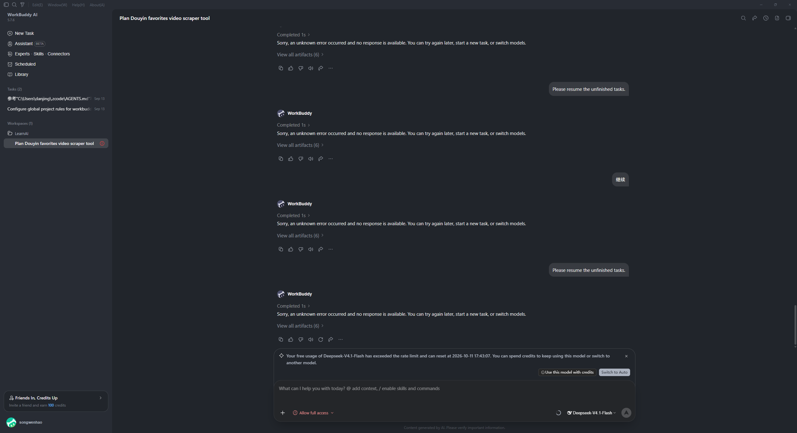

# One Dark Pro for WorkBuddy AI

Atom 的传奇 **One Dark Pro** 配色（[Binaryify/OneDark-Pro](https://github.com/Binaryify/OneDark-Pro)，MIT）移植到 [WorkBuddy AI](https://www.workbuddy.ai)（腾讯 CodeBuddy 海外版桌面端）的主题项目，结构与 [onedark-dsh-theme](https://github.com/songwenhao/onedark-dsh-theme) 同源：

- 🎨 **一套调色板源文件**（`palette/onedark.mjs`），生成全部产物
- 🖥️ **CDP 注入主题器**——通过 WorkBuddy 官方支持的 `WORKBUDDY_REMOTE_DEBUGGING_PORT` 开关换肤，**零文件修改**，退出应用即完全还原
- 📦 **官方皮肤包格式**（`skin-package/`，manifest + CSS zip）——留作未来上架官方「个性主题」渠道

## 主题

| 主题 | 主背景 | 侧栏/工具区 | 说明 |
| --- | --- | --- | --- |
| **One Dark Pro** | `#282c34` | `#21252b` | 经典默认外观 |
| **One Dark Pro Darker** | `#23272e` | `#1e2227` | 整体更深一档 |
| **One Dark Pro Night Flat** | `#16191d` | `#1e2227` | 近纯黑的 OLED 友好变体 |

三个变体只调整背景梯度，语法色与上游各变体完全一致。



## 安装与使用（CDP 注入，本机立即可用）

要求：Node.js ≥ 22（用了原生 WebSocket），Windows。

```sh
# 方式一：一键启动器（推荐）——以官方调试开关启动 WorkBuddyAI 并注入
pwsh -File Start-OneDarkPro.ps1

# 方式二：npm scripts
npm run launch        # 启动 WorkBuddyAI（WORKBUDDY_REMOTE_DEBUGGING_PORT=9223）并注入
npm run apply         # 向已在运行的实例（须以调试开关启动）重新注入
npm run stop          # 摘除主题（也可以直接彻底退出 WorkBuddyAI，零残留）
npm run status        # 查看 CDP 端口状态

# 变体
npm run launch -- --variant onedark-darker
npm run launch -- --variant onedark-night-flat
```

- **彻底退出 WorkBuddyAI 再用启动器打开**，是最可靠的方式（普通方式已启动的实例无法补开调试端口）。
- 注入器会同时：
  1. 设置 `body[data-vscode-theme-name="One Dark Pro"]` + `data-vscode-theme-kind="vscode-dark"`——WorkBuddy 自带的 MutationObserver 会走官方代码路径补齐暗色类和 `color-scheme`；
  2. 把皮肤 CSS 装进 `document.adoptedStyleSheets`（级联优先级天然压过内置令牌表，也不受 CSP 限制）；
  3. 用 `Page.addScriptToEvaluateOnNewDocument` 注册文档级脚本，页面重载后自动重挂；
  4. 写入 `agent-ui-theme` localStorage，下次冷启动应用自己以暗色起窗。
- 注入器默认驻留观察新窗口（设置窗等）并自动注入；Ctrl+C 只退出注入器，应用继续运行。

## 官方皮肤包（未来渠道上架用）

WorkBuddy 的「个性主题」皮肤是云端 zip（CSS + 媒体资源），下载域名白名单锁定腾讯 CDN，本地无法直接侧载。本仓库同时产出符合皮肤加载器格式的包，便于将来通过官方渠道分发：

```sh
npm run package:skin   # 生成 skin-package/workbuddy-onedark-pro-skin.zip
```

包内 `manifest.json` 指向 `onedark-pro.css`；皮肤加载器读不到 manifest 时也会自动抓取 zip 里第一个 `.css` 文件。

## 设计映射

WorkBuddy 的颜色体系是三级 CSS 变量（`renderer/assets/tokens-*.css` + `lib-chat-ui-*.css`），本主题照搬 onedark-dsh-theme 的别名令牌思路，只覆盖源头：

- **背景阶梯（`--wb-palette-gray-*`）**：`#1d1f23`（输入框底）→ `#21252b`（侧栏）→ `#282c34`（主表面）→ hover `#2a2f37` → 凸起 `#3e4452`，全部取自上游 OneDark-Pro 工作区配色。
- **品牌色（`--wb-palette-brand-*`/`blue-*`）**：`#61afef`（One Dark Pro 蓝）替换默认的 WorkBuddy 绿/蓝，所有语义令牌（链接、选中、气泡、按钮）自动跟随。
- **文字层级**：正文 `#abb2bf`、次级 `#9da3ae`、三级 `#868c97`。
- **VS Code 镜像变量（`--vscode-*`）**：桌面端渲染器直接消费 `var(--vscode-editor-background, …)` 等变量，皮肤里给了完整的 One Dark 映射（编辑器/侧栏/输入框/滚动条/菜单/按钮）。
- **代码块（ChatGPT 观感）**：代码区比页面亮一档（Pro 上即 `#32373f`），头部条与代码区同色，跟随 `.cb-markdown` 的令牌。
- **语法色（highlight.js，`--cb-hljs-*`）**：keyword `#c678dd`、string `#98c379`、number/literal `#d19a66`、function `#61afef`、variable `#e06c75`、comment `#5c6370`，另加 type/class `#e5c07b` 等润色规则。

## 开发

```sh
node scripts/gen-css.mjs   # 重新生成 skin/*.css（调色板与映射公式都在 palette/ 与该脚本里）
```

改配色只动 `palette/onedark.mjs`，运行生成即可；不要手改 `skin/*.css`。

## 已知局限

- **启动器环境**：若你的终端里带 `ELECTRON_RUN_AS_NODE=1`（Electron/DSH 等宿主常见），WorkBuddyAI.exe 会被当成纯 Node 启动并静默退出——启动器已自动剥离该变量，无需处理。
- **Monaco 代码块**（工件预览、diff 视图）的主题在应用 JS 里写死（IDE Light/Dark/Night），CSS 管不到；聊天内的 highlight.js 代码块不受影响。随暗色基座显示，无碍大体观感。
- **官方皮肤互斥**：若在应用内启用了云端「个性主题」，注入器会让位给官方皮肤（检测 `data-skin` 属性）。
- 皮肤上架：需官方渠道下发资源目录（`resourceKey` 由服务端目录分配），本地 zip 不可直接导入。

## 致谢

- [Binaryify/OneDark-Pro](https://github.com/Binaryify/OneDark-Pro) — One Dark Pro 主题（MIT）
- [songwenhao/onedark-dsh-theme](https://github.com/songwenhao/onedark-dsh-theme) — 本项目参照的 DSH 主题插件结构与调色板来源
- [DeepSeek Harness](https://github.com/deepseek-ai/deepseek-harness) / Tencent WorkBuddy AI — 宿主应用

## License

[MIT](LICENSE) © 2026-present workbuddy-onedark-theme contributors
